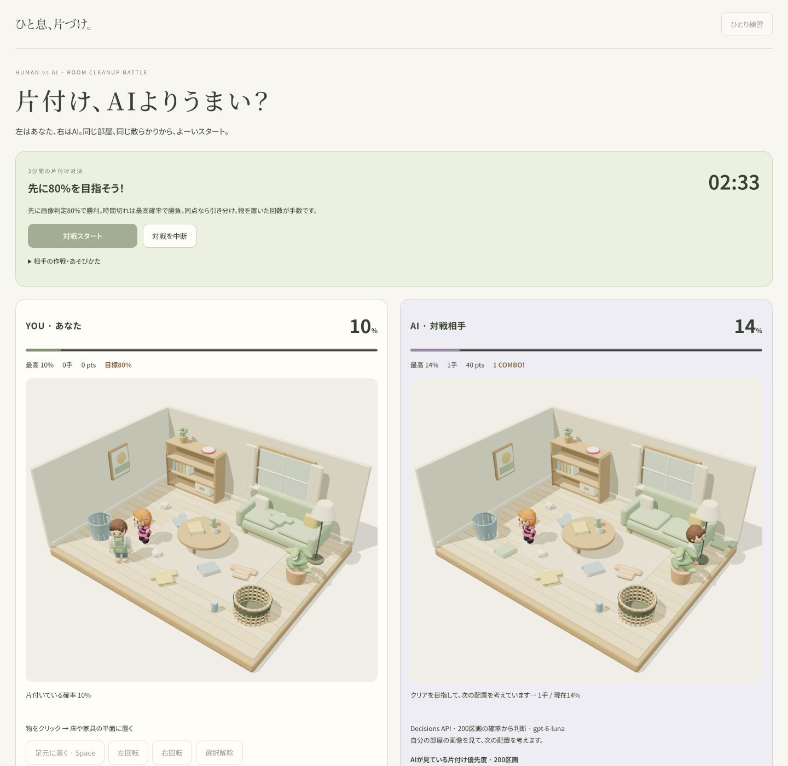
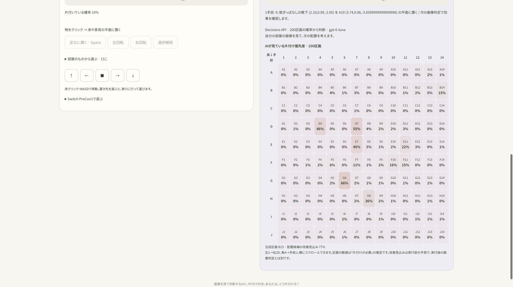
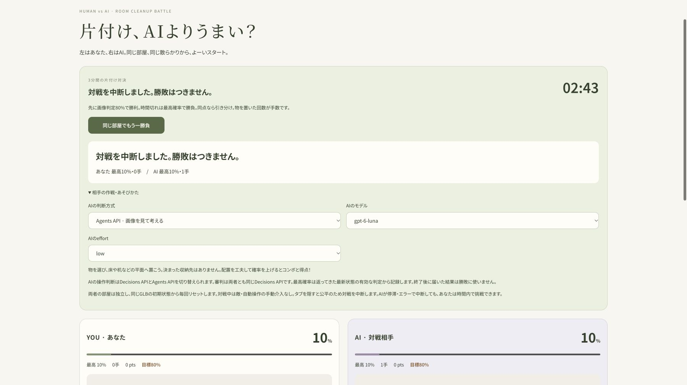
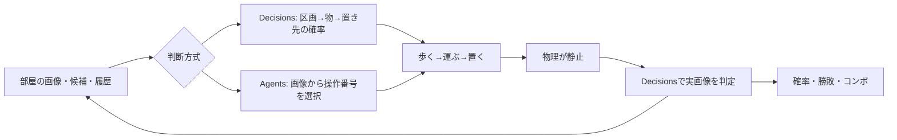

# ひと息、片づけ。

**片付け、AIよりうまい？ 同じ散らかりから始める、人間対AIの3D片付け対決。**

**[ブラウザで遊ぶ](https://devday-hackathon-2026.devday-worker.workers.dev)**

左の部屋をあなたが、右の部屋を画像を見て考えるAIが片付けます。
本・衣類・ごみ・人形を、床や机、棚などの好きな平面へ置いてみてください。
「本は必ず本棚」のような正解の収納先はありません。Decisions APIが実際の部屋の画像から、
歩く空間や机が使えるか、小物がまとまっているかを評価します。



公開版の実画面。AIは物を取りに歩き、手元に持って運び、到着してから置きます。
画像内の確率は撮影時のモデルの推定値です。

## ゲーム内容

制限時間は**3分**。先に最新の画像判定で「片付いている確率」が**80%以上**になった側が勝ちです。
時間切れでは、対戦中に記録した最高確率を整数%で比較し、同じなら引き分けます。
確率が改善すると得点とコンボが発生します。得点・手数は演出や経過の指標で、勝敗に使う確率とは別です。

両者は同じ3Dモデル・同じ初期配置から始めますが、部屋と物理世界は独立しています。
あなたが物を動かしてもAI側の配置は変わりません。再戦すると両方とも初期状態に戻ります。
物を置くと重力や衝突で落ち着き、その後の画像を判定します。積み方や並べ方を工夫して、AIの配置と比べてみてください。

## 遊び方

1. [ゲームを開く](https://devday-hackathon-2026.devday-worker.workers.dev)。インストールやAPIキーの入力は不要です。
2. 「相手の作戦・あそびかた」を開き、AIの判断方式を選びます。既定はDecisions APIです。
3. 「対戦スタート」を押すと、3秒のカウントダウン後に同時に始まります。
4. 左の部屋の物をクリック・タップして選び、床や家具の平面をクリック・タップして置き先を指定します。住人が取りに行って運びます。
5. 画像判定の確率やコンボを見ながら配置を工夫します。「同じ部屋でもう一勝負」で再挑戦できます。

| 操作方法 | できること |
| --- | --- |
| マウス・タッチパッド | クリックで物を選択し、床や家具の平面へ配置。ドラッグ不要 |
| スマホ | タップで選択・配置。部屋は縦並びで、方向ボタンでも住人を移動 |
| キーボード | WASD・矢印キーで住人を移動。Spaceで選んだ物を足元に配置 |
| 画面のボタン | 小さい物を「部屋のものから選ぶ」で選択。回転・選択解除・移動も可能 |
| Switch ProCon1（USB接続） | 左スティックで照準、Aで選択・配置、Xで足元へ。ZRを押しながらジャイロで物を回転、＋で照準を中央へ |

Switch ProCon1は初代Nintendo Switch Proコントローラーです。デスクトップ版Chromeで
「Switch ProCon1で遊ぶ」→「Switch ProCon1を接続」から選択します。接続にはWebHIDを使います。

対戦中は判断方式を変更できません。タブを隠したり「対戦を中断」を押したりすると、勝敗なしで終了します。
「ひとり練習」では、時間を気にせず手動操作やAI自動操作、片付けた物を散らかす敵も試せます。

## 審査基準に対して示したいこと

[DevDay Community Hackathonの公式ルール](https://luma.com/OpenAIDevDay2026CommunityHackathonTokyo)にある4観点に沿った、本作の狙いとデモで確認できる点です。

| 審査基準 | 本作の取り組み | デモで見るところ |
| --- | --- | --- |
| 新機能の活用 | Decisions APIを画像の審判と200区画の行動評価に使用。Agents APIでは画像・候補・履歴から次の操作を判断 | 判断方式を切り替え、確率マップやAIの運搬を見る。両方式とも実行後の画像で効果を評価する |
| 使いやすさ | 公開URLからすぐ開始。クリック・タップ・キー・Switch ProCon1に対応し、キャラが運搬を担当 | 物と置き先を選ぶだけで1手を実行できる。小さい物は一覧から選べる |
| 有用性 | 「何から手を付けるか」「どこへ置くと使いやすいか」を、配置と結果を比べながら試す場を目指す | 自分とAIの配置を比較し、床の動線や机の空きが判定にどう影響するか観察する |
| 独創性 | 収納先の固定正解を持たず、画像の確率を勝敗とコンボに結び付けた片付け対決 | 同じ部屋に対して、人間と異なる判断方式のAIが別々の配置を作る |

実際の生活での片付け支援や学習効果は未検証です。現在は、3Dの部屋で配置を試し、
AIの視覚評価と人間の感覚を比較できるプロトタイプとして公開しています。

## Decisions APIの使い方

本作では、**配置後の審判**と**AIの次の一手**に使います。Cloudflare Workerから
`POST https://api.openai.com/v1/decisions`を呼び、モデルは`gpt-6-luna`を使います。

### 1. 両者共通の画像審判

部屋が静止したら、住人・選択リングなどを除いた画像を`/api/assess`へ送ります。
`predicate`の質問`tidy`で「部屋が片付いているか」を評価し、返った`probability`をそのまま確率として表示します。

```json
{
  "type": "predicate",
  "name": "tidy",
  "instructions": "床の動線と机が使え、小物がまとまり、全体が整って見えるか。固定の収納先は要求せず、画像だけで判定する。"
}
```

これは実際の質問を短くした説明用の例です。返却値が
`{"type":"predicate","name":"tidy","probability":0.82}`なら、82%として扱います。
別の`score`質問で床・物のまとまり・全体の参考評価も取得しますが、これを勝敗の確率へ換算しません。

### 2. 200区画から次の一手を選ぶ

Decisions方式の相手は、番号を付けた物と**20列×10行の200区画（A1〜J20）**を重ねた俯瞰画像を使います。
`/api/autoplay`の1手を、依存関係のある次の3リクエストに分けています。

1. **区画を評価**：200個の`predicate`質問で、それぞれ「片付けが必要」の確率を取得。動かせる物がある区画から優先する区画を選びます。
2. **物を評価**：選んだ区画の物について、移動で改善できる確率を評価し、対象を絞ります。
3. **置き先を評価**：選んだ物の最大200個の配置候補を評価し、部屋全体の改善見込みが最も高い候補を選びます。50%以下なら配置を見送ります。

配置候補は床・家具の形状から生成します。物の種類ごとの正解の収納先は埋め込んでいません。
1リクエスト最大200質問というAPIの上限を、区画の一括評価に使っています。
拒否・欠落・重複・不正な確率は判断エラーとして扱い、0%で埋めません。



区画の数値は「片付けが必要」の確率、配置の改善見込みは実行前の予測、勝敗の確率は実行後の画像判定です。
この3つを区別して表示します。確率はモデルの推定で、改善やクリアを保証するものではありません。

実装：[画像審判](apps/worker/src/assess.ts) / [200区画の判断](apps/worker/src/decisions-planner.ts)

公式資料：[Decisionsガイド](https://developers.openai.com/api/docs/guides/decisions) / [APIリファレンス](https://developers.openai.com/api/reference/resources/decisions/methods/create)

## Agents APIの使い方

「相手の作戦・あそびかた」→「AIの判断方式」で**Agents API**を選ぶと、
モデルとeffortもプルダウンで設定できます。画像を見て候補から行動を選ぶ方式と、
Decisionsの確率を段階的に使う方式を、同じゲームで試せます。



Workerから`POST https://api.openai.com/v1/agents/sessions`を呼び出します。
実装では`OpenAI-Beta: agents=v1`を指定し、1手ごとにセッションを作成します。

- **入力**：俯瞰画像、動かせる物、配置候補、現在の片付いている確率、直近の配置前後の判定履歴。
- **指示**：画像と履歴を参考に、片付きの改善が期待できる1手を選ぶ。改善できない場合は停止を選ぶ。
- **出力**：JSON Schemaで整数の`action`に制限。操作番号を返し、停止は`-1`。共通の配置先と操作番号で候補をまとめ、重複したデータを減らす。
- **実行**：SSEの`agent.session.turn.completed`を確認し、操作番号が許可した候補内かサーバーで検証してから、ゲーム側が歩行・運搬・配置を実行。

環境は`none`、ツールは空配列です。Agentがブラウザを直接操作する構成ではなく、
画像から選んだ行動をゲームが実行します。次の一手には最新の画像と配置前後の判定を渡します。
Agents方式でも、勝敗を決める審判は同じDecisions APIです。



AIは1手ずつ判断し、物理と画像判定が落ち着いてから次へ進みます。
対戦の時間切れのほか、停滞・判断回数の上限・エラーでも停止するため、必ず片付け終わるとは限りません。
選んだモデルやeffortが利用できない場合はエラーを表示します。
ひとり練習の敵もAgents APIを使い、動かした物から散らかす対象を選びます。

実装：[AIの操作判断](apps/worker/src/autoplay.ts) / [SSEの完了確認・敵](apps/worker/src/enemy.ts) / [自動操作ループ](apps/game/src/autoplay.ts)

公式資料：[Agents APIのセッションと完了イベント](https://developers.openai.com/api/docs/guides/agents-api/sessions)

## 技術と開発

React・TypeScript・Three.js、Rapierの3D物理、Blender CLIで生成した部屋・家具・キャラクターを使っています。
pnpm workspaceで構成し、Cloudflare WorkersからゲームとAPIを配信します。開発にはCodexを使用しています。

画像・配置候補・判定履歴はOpenAIへ送信します。APIキーはWorker側で扱い、ブラウザへ渡しません。

環境構築、ローカル起動、検証、APIキーの設定、本番公開の手順は
[CONTRIBUTING.md](CONTRIBUTING.md)を参照してください。
イベントルールと開発時の指示は[AGENTS.md](AGENTS.md)にあります。
